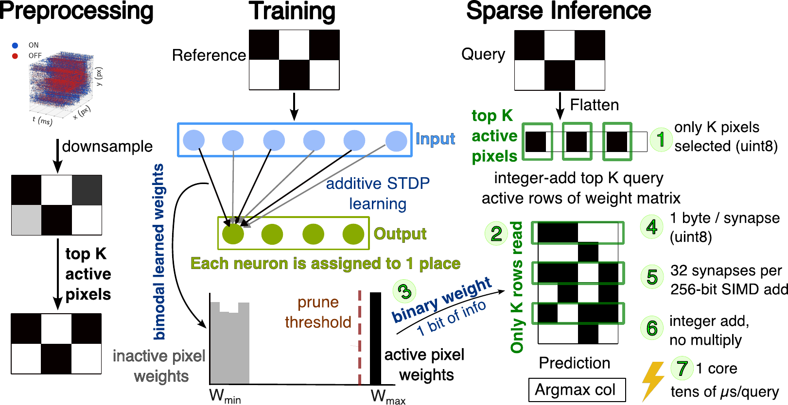

# Removing the Compute Bottleneck for Event-based Visual Place Recognition with Spiking Neural Networks

Code for the paper by Somayeh Hussaini, Tobias Fischer and Michael Milford ([arXiv:2610.16022](https://arxiv.org/abs/2610.16022)).

We train a two-layer spiking neural network (SNN) with additive STDP, which makes the learned weights bimodal so that most of them can be pruned. At inference, a query only reads the pruned weights of its K active pixels, stored as a one-byte mask, and each place's score becomes an integer count. A query takes tens of microseconds on one CPU core.


<sub>Method overview. Preprocessing: event windows become frames of their top-K active pixels. Training: additive STDP with winner-take-all assigns one output neuron per reference place and makes the weights bimodal, so a single threshold prunes them to a binary mask. Sparse inference: a query reads only the K mask rows of its active pixels and sums them with integer SIMD adds.</sub>

This repository contains the four methods compared in the paper. All of them use the same top-K binary frames and the same ground truth:

| Method | What it does | Runs on |
|---|---|---|
| **Sparse SNN** (ours) | sums the uint8 synapse-mask rows of the query's K active pixels | 1 CPU core |
| **Dense SNN** (ours) | full float32 matrix-vector product over the same pruned weights | all physical CPU cores |
| **SAD** | Hamming distance between bit-packed frames | 1 CPU core |
| **LENS** | the [LENS](https://github.com/AdamDHines/LENS) network (git submodule), trained with its own code | GPU |

## Installation

```bash
git clone --recursive https://github.com/Somayeh-h/SparseSNN-VPR.git     # or, in an existing clone: git submodule update --init
cd neuromorphic_vpr
pixi install                           # https://pixi.sh, Linux x86-64
```

STDP training (JAX) and LENS (PyTorch) run on a CUDA 12 GPU. Without an NVIDIA driver, install with `CONDA_OVERRIDE_CUDA=12.1 pixi install`; both then run on the CPU, more slowly. Our SNN kernels and SAD always run on the CPU with numba.

## Quick start on synthetic data (no download)

```bash
pixi run synthetic
```

This trains and runs all four methods on 200 random 32x32 frames with 100 active pixels each. The queries are the reference frames again, so each method should report R@1 = 100% (200/200). It takes about 2 minutes and only checks that everything runs end to end. It says nothing about accuracy on real data, and the preprocessing latency is not meaningful because the frames are generated directly, with no event window to bin.

## Datasets

We use QCR-Event-VPR, Brisbane-Event-VPR and NSAVP in the format prepared by [Event-LAB](https://github.com/AdamDHines/Event-LAB). Download them with Event-LAB. The scripts look for them in `../Event-LAB/datasets/<dataset>/` (Event-LAB next to this repository); to use another location, set `EVENT_LAB_DATASETS=/path/to/Event-LAB/datasets` or pass `--event_data_dir` for a single dataset. The expected files are:

```
<dataset dir>/<sequence>/<sequence>.hdf5                                          qcr_event, brisbane_event
<dataset dir>/<sequence>/<sequence>_dvxplorer_left.h5, <sequence>_applanix.h5     nsavp
<dataset dir>/ground_truth/<sequence>_ground_truth.nmea                           brisbane_event
```

| Dataset | Reference -> query | Window |
|---|---|---|
| QCR-Event | normal2 -> normal3 | 100 ms, 1600 frames |
| Brisbane-Event | sunset1 -> sunset2 | 1 s, whole traverse |
| NSAVP | R0_FS0 -> R0_FA0 | 1 s, whole traverse |

Each window becomes a 32x32 binary frame of its K = 100 most frequently hit pixels. A query is correct if its match is within 10 frames of the ground truth.

## Reproducing the paper

Each step is a pixi task (`pixi task list` shows them all):

| Task | What it runs |
|---|---|
| `pixi run qcr`<br>`pixi run brisbane`<br>`pixi run nsavp` | trains our SNN, then runs Dense SNN, Sparse SNN, SAD and LENS on one dataset |
| `pixi run stage-breakdown` | per-stage latency of both SNN kernels on QCR-Event (needs `qcr`) |
| `pixi run plots` | the comparison figures, the latency-decomposition table and figures, from the results above |
| `pixi run all` | all of the above, in order |

Results go to `outputs/main_results/`. All tasks except `plots` measure latency, so run one at a time on an otherwise idle machine. Training is deterministic, so R@1 is reproduced exactly; latencies depend on the machine (ours: Intel Core i7-10700K, RTX 3080).

### Running a single script

The tasks call four scripts that share the same command-line arguments (`python train.py --help`; the defaults are the QCR-Event setting):

```bash
DATA="--event_dataset qcr_event --pixels_per_image 100"
pixi run python train.py $DATA --output_path outputs/qcr                            # STDP training -> checkpoint
pixi run python infer.py $DATA --checkpoint outputs/qcr --output_path outputs/qcr   # Dense + Sparse SNN
pixi run python sad_inference.py $DATA --output_path outputs/sad_qcr
pixi run python lens_event_inference.py $DATA --output_path outputs/lens_qcr
```

Each inference script writes `results.json` (R@1, R@N, mean preprocessing and network latency per query; for `infer.py`, one entry each for `"dense"` and `"sparse"`), the per-query latencies and predictions (`*_latency.npz`) and a `logs.txt`, plus three plots: the ground-truth matrix (`gt_matrix_built.png`), the similarity matrix with each prediction marked (`vpr_similarity_matrix*.png`), and the query, its true and its matched reference for the first 20 queries (`query_matches/`). `train.py` also plots each neuron's weights on the pixels of its own place against all others (`stdp_active_vs_inactive_weights.png`).

## How latency is measured

Queries are processed one at a time, without batching. Each query's call is timed in two parts:

- **preprocessing**: from the raw event window to the kernel's input (the top-K active pixels, a full binary frame, or a bit-packed frame);
- **network**: the call that returns the predicted place, including the argmax. For LENS, this includes the copy of the frame to the GPU and of the prediction back.

Each query inference call is repeated 10 times (`--n_timing_repeats`). A query's latency is the median of its repeats, which ignores occasional scheduler stalls, and we report the mean over all queries. Windows with more than 20,000 events are subsampled as 256 contiguous runs (`--query_max_events_per_window`), which bounds the preprocessing cost on Brisbane-Event and NSAVP.

### Where the Sparse SNN's speedup comes from

`infer.py` also times two reference kernels in the same run: the dense kernel on one thread, and a *gather-sum* kernel that walks the same K rows as the Sparse SNN but over float32 weights. `plots/make_latency_decomposition_table.py` uses them to split the measured kernel speedup `S_total = t_dense / t_sparse` into four factors whose product is exact:

| Factor | Definition | Effect |
|---|---|---|
| fewer weights visited | `S_work = N_in / K` | speedup |
| single-threaded | `S_threads = t_dense,1-thread / t_dense` | slowdown |
| accumulator in memory, not registers | `S_gather = S_work * t_gathersum / t_dense,1-thread` | slowdown |
| uint8 mask, 32 SIMD lanes, integer add | `S_repr = t_gathersum / t_sparse` | speedup |

so that `S_total = S_work * S_repr / (S_threads * S_gather)`. `benchmarks/kernel_stage_breakdown.py` further splits each SNN kernel into stages (call overhead, thread fork/join, accumulate, readout + argmax) by timing truncated copies of the fused kernel, so the stages add up to the real kernel time.

## Citation

If you use this code, please cite:

```bibtex
@article{hussaini2026removing,
  title={Removing the Compute Bottleneck for Event-based Visual Place Recognition with Spiking Neural Networks},
  author={Hussaini, Somayeh and Fischer, Tobias and Milford, Michael},
  journal={arXiv preprint arXiv:2610.16022},
  year={2026}
}
```

## Acknowledgements

This work received funding from ARC Laureate Fellowship FL210100156 to MM. The authors acknowledge continued support from the Queensland University of Technology (QUT) through the Centre for Robotics.
